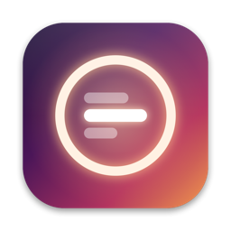
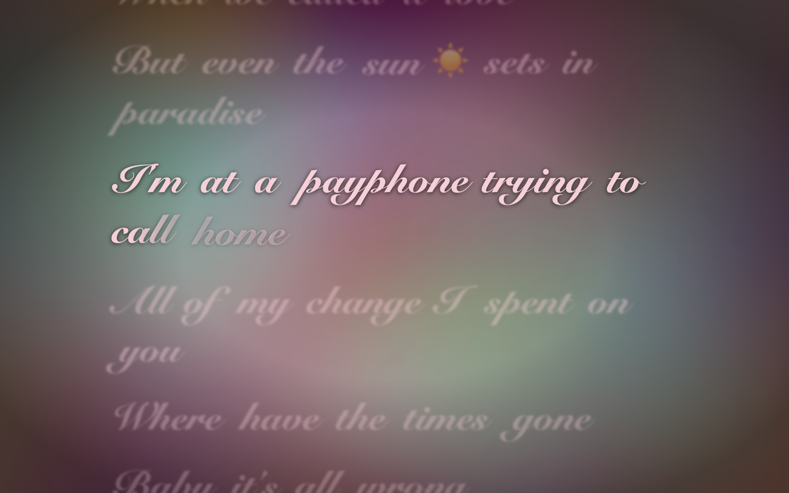
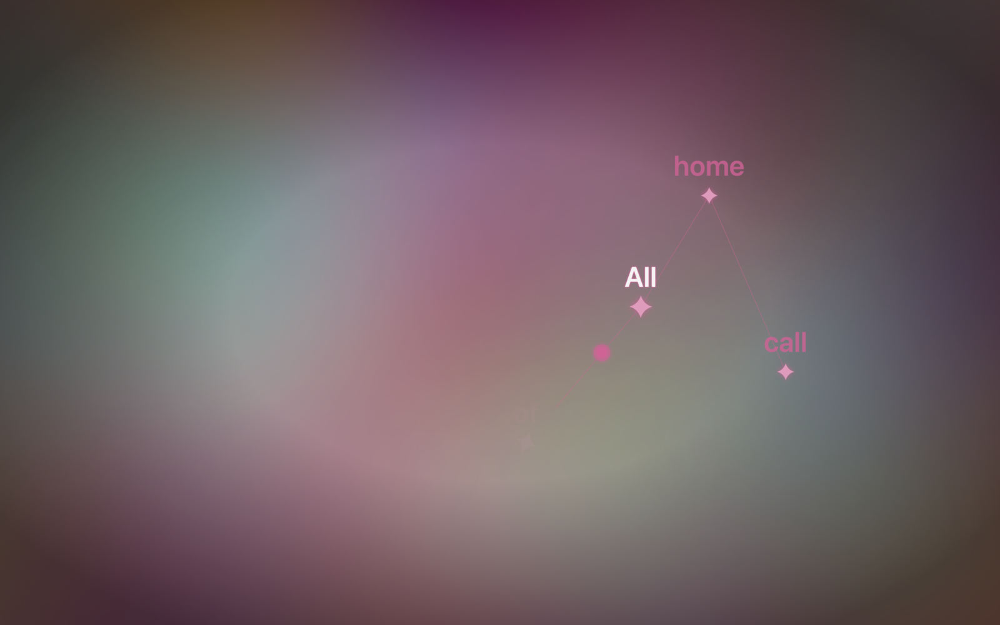

<p align="center"></p>

<h1 align="center">Lyra</h1>

<p align="center"><b>Live lyrics as your Mac wallpaper.</b><br>
The song playing in Apple Music or Spotify becomes a moving wallpaper in its album colours,<br>
with the lyrics lighting up word by word, on your desktop and lock screen.</p>

<p align="center"><a href="../../releases/latest"><b>⬇ Download for Mac (free)</b></a></p>

<p align="center"> </p>

## Features

- **Live wallpaper from the album art.** Soft colour clouds that move at the song's pace and pulse on the beat.
- **Word-by-word lyrics** for millions of songs, with real word timing where available.
- **12 lyric styles:** Glow, Spotlight, Focus, Depth, Marker, Ribbon, Constellation, Motion, Neon, Poster, Brush and Lens.
- **Auto mode** picks the best style for each song and gives every section (verse, chorus, bridge) its own look.
- **Arabic and English**, each with its own fonts, right-to-left done properly.
- **Lock screen:** the same live wallpaper with a clock and the lyrics.
- **Ring light:** a glow around your screen edges in the song's colours that flares on beats.
- **Click the song card** in the bottom-left corner to switch between the live wallpaper and your own.
- **Light on battery:** the animation runs on the graphics card; Lyra itself uses about 2–5% CPU while playing.

## Install

1. Download the zip for your Mac from **[Releases](../../releases/latest)**:
   - **Lyra-AppleSilicon.zip** for M1, M2, M3 and M4 Macs
   - **Lyra-Intel.zip** for Intel Macs

   Not sure which? Apple menu  → About This Mac → *Chip* (Apple M…) or *Processor* (Intel).
2. Unzip it and drag **Lyra** into your **Applications** folder.
3. **First launch:** Lyra is free and isn't sold through Apple, so macOS warns that it "can't verify the developer". Right-click **Lyra** → **Open** → **Open**. You only do this once.
   If macOS says the app is *damaged*, open Terminal and run:
   ```bash
   xattr -cr /Applications/Lyra.app
   ```
4. Play a song in Apple Music or Spotify. Allow Lyra to control the music app when asked, so it can see what's playing.
   For beat effects, also allow **Screen & System Audio Recording** (System Settings → Privacy & Security). Lyra only listens to the music's volume; nothing is recorded or saved.

The Lyra icon appears in your menu bar. Click it for the settings; right-click it to turn Lyra off or quit.

**Requires macOS 14 Sonoma or later.**

## Tips

- **Lyrics a bit early or late for one song?** Use the − / + buttons next to *Lyrics timing* in the menu. Lyra remembers the fix for that song.
- **No lyrics found?** Some songs only have line-by-line lyrics or none at all. Lyra shows the title card instead.

## Build from source

Needs the Xcode Command Line Tools (`xcode-select --install`), not the full Xcode app.

```bash
./build.sh --install    # build Lyra.app for this Mac and copy it to /Applications
./build.sh --release    # also make dist/Lyra-AppleSilicon.zip and dist/Lyra-Intel.zip
```

## How it works

| Piece | Where | Notes |
|---|---|---|
| Now playing | `NowPlaying.swift` | Reads Music and Spotify with AppleScript about once a second and interpolates in between. |
| Lyrics | `Lyrics.swift` | [LRCLIB](https://lrclib.net) and NetEase; word times are estimated from syllables when only line timing exists. Cached on disk. |
| Wallpaper | `Wallpaper.swift` | Core Animation layers with long-running animations, so the window server animates them. |
| Lyric styles | `ListScene.swift`, `Styles.swift`, `NewStyles.swift`, `Director.swift` | Each word is pre-rendered once, on the GPU, into an image with its effects; animating is then just moving images. |
| Auto | `Profile.swift`, `Analysis.swift` | Picks a style per song from its genre, tempo, language and timing, and a treatment per section. |
| Beats | `AudioReactor.swift` | A Core Audio process tap on the music app, with bass-onset detection. |
| Lock screen | `Overlay.swift` | Uses private SkyLight functions to show a window above the lock screen. |

## Privacy

Lyra has no account, no analytics and no tracking. It only contacts lyrics services (LRCLIB, NetEase) and Apple's public iTunes Search API, sending the song title and artist.

## License

[MIT](LICENSE). Lyrics belong to their artists and are fetched from public lyrics services at play time; none are included in this project.
